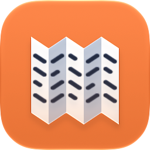
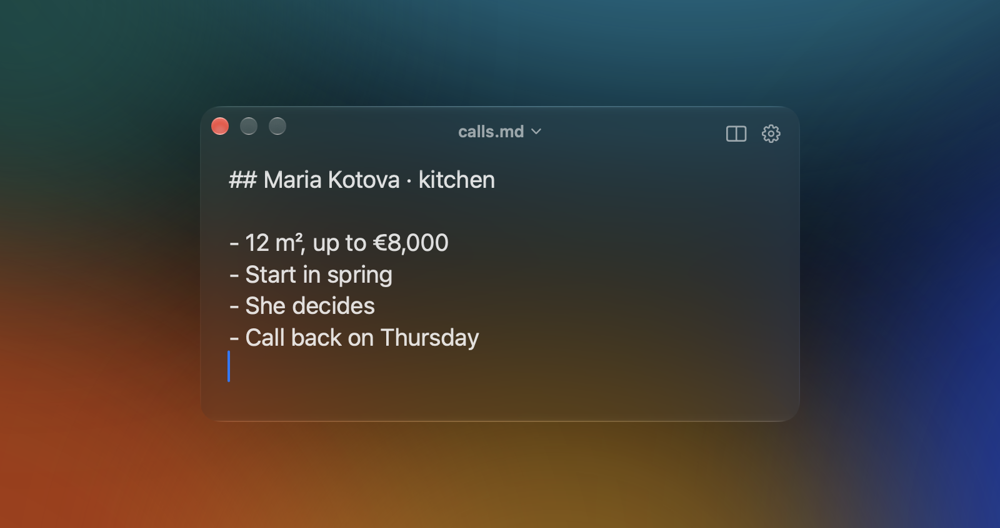
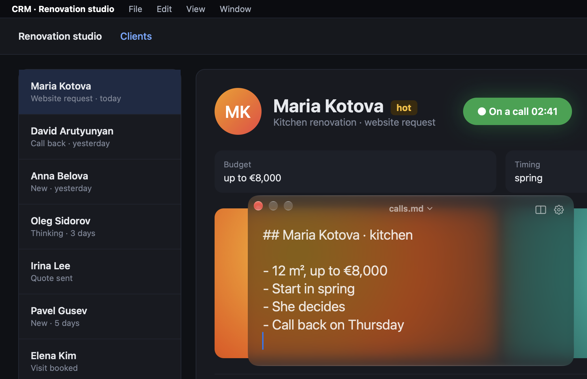
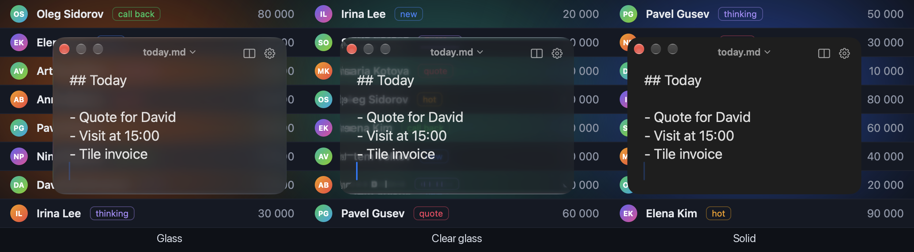
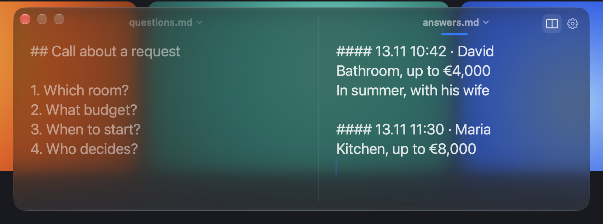

# Shpora

**English** · [Русский](README.ru.md)

**A cheat sheet that floats above every window.** One hotkey shows your Markdown file over any app — you type, and it's already saved. Made for calls: your dialer or CRM stays full-screen, your questions and notes stay on top.



## Download

1. Download the latest **Shpora-….zip** from [Releases](https://github.com/nagornik-icloud/shpora/releases/latest) and unzip it.
2. Move **Shpora.app** to **Applications** and open it.
3. The first time, macOS says it can't verify the developer (the app isn't notarized by Apple yet). Click **Done**, then open **System Settings → Privacy & Security**, scroll down and click **Open Anyway** next to Shpora. You only do this once.

   Or in Terminal: `xattr -dr com.apple.quarantine /Applications/Shpora.app`
4. Press ⌃⌥J.

Works on Apple silicon and Intel Macs with macOS 26 or later.

## What it does

### Always in sight
Press ⌃⌥J and the window floats above any app, even a full-screen one. It doesn't take focus away from the app you're in — your dialer, browser or CRM keeps working. Press ⌃⌥J again to hide it.



### Three looks
Glass, clear glass or a solid background — you decide how much the window lets through. Light and dark follow your system.



### Two files side by side
⌘D opens a second file next to the first: call questions on the left, client answers on the right. Near the screen edge the window slides over so the pane fits. Drag the divider to resize, ⌘[ / ⌘] jump between panes, ⌘W closes the second one.



### A live file
The window *is* your .md file: there's no Save button. Changes hit the disk within a fraction of a second, and right away when the window hides, the app quits or the Mac sleeps. Writes are safe (temp file, then swap). Edit the file in Obsidian or any editor and the window picks it up; if both sides edited at once, nothing is overwritten — your version is saved as a copy next to the file.

## Also

- ⌘T inserts a timestamp line (`#### 13.11 10:42 · `) — handy to start a new entry.
- ⌘F search · ⌘+ / ⌘− / ⌘0 text size · ⌘O open the file in its default app · Esc hide.
- Shortcuts work on any keyboard layout; the hotkeys are yours to change in Settings.
- Remembers its size and place, separately for one and two panes.
- Pick any file from the menu under its name; add or create files from there.
- Optional Dock and menu-bar icons, open at login. English and Russian.
- Coming from Markie? On first launch Shpora picks up its file list (read-only, Markie is not touched).

## What it doesn't do (on purpose)

- No Markdown rendering: you see and edit the plain text.
- No sync, accounts or cloud — files live where you put them (put them in iCloud Drive or Dropbox if you want sync).
- No version history, daily notes or task lists.

## Planned

- Auto-update (Sparkle).
- A build notarized by Apple, so macOS opens it without the extra step.
- Homebrew install.

Ideas and bug reports are welcome in Issues.

## Build from source

You need macOS 26+, Xcode and [XcodeGen](https://github.com/yonaskolb/XcodeGen) (`brew install xcodegen`).

```bash
git clone https://github.com/nagornik-icloud/shpora.git
cd shpora
scripts/build.sh
```

The script builds a Release version, signs it (your Apple Development certificate if you have one, otherwise ad-hoc) and copies it to `/Applications/Shpora.app`. Then open Shpora and press ⌃⌥J.

## Credits

Global hotkeys: [KeyboardShortcuts](https://github.com/sindresorhus/KeyboardShortcuts) by Sindre Sorhus (MIT).

## License

[MIT](LICENSE)
