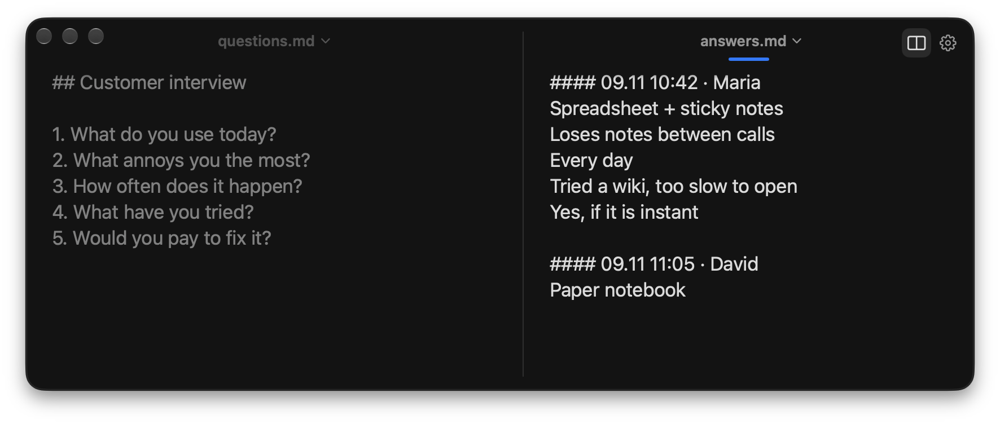
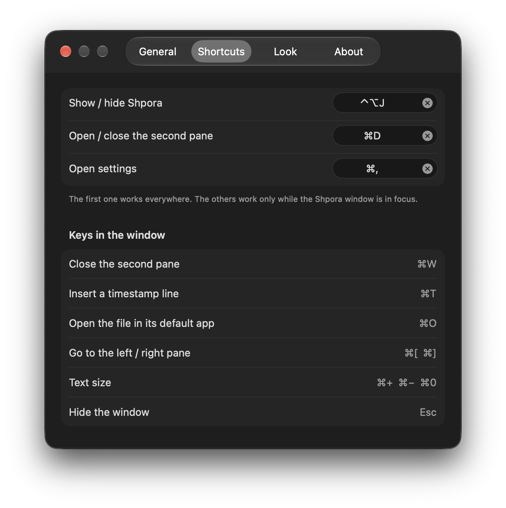
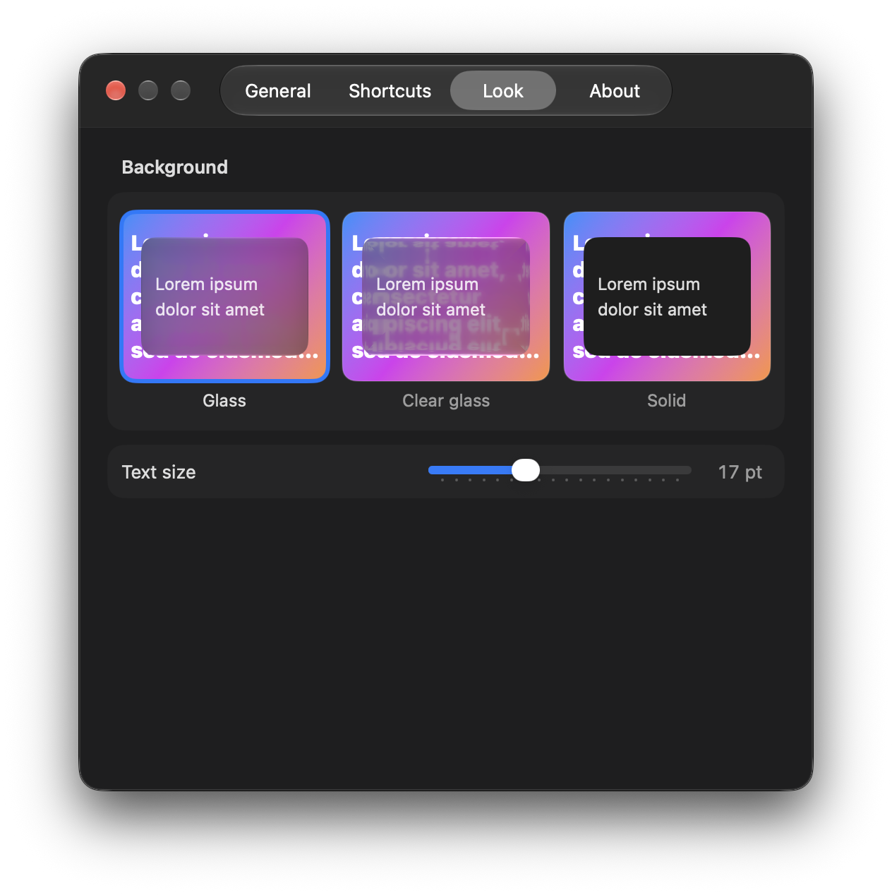

# Shpora

[English](README.md) · **Русский**

Маленькая программа для macOS: быстрые заметки поверх всех окон. Одна горячая клавиша открывает живой Markdown-файл — печатаешь, и он уже сохранён. Рядом можно открыть второй файл: например, слева вопросы для звонка, справа ответы.



## Скачать

1. Скачай свежий **Shpora-….zip** со страницы [Releases](https://github.com/nagornik-icloud/shpora/releases/latest) и распакуй.
2. Перетащи **Shpora.app** в **Программы** и открой.
3. В первый раз macOS скажет, что не может проверить разработчика (программа пока не заверена Apple — см. «В планах»). Нажми **Готово**, затем открой **Системные настройки → Конфиденциальность и безопасность**, пролистай вниз и нажми **Всё равно открыть** рядом с Shpora. Это нужно сделать один раз.

   Или в Терминале: `xattr -dr com.apple.quarantine /Applications/Shpora.app`
4. Нажми ⌃⌥J.

Работает на Mac с процессорами Apple и Intel, macOS 26 и новее.

## Что умеет

**Окно**
- Показывается и прячется горячей клавишей (по умолчанию ⌃⌥J, меняется в настройках).
- Всегда поверх всего, в том числе полноэкранных программ, и не забирает фокус у программы, в которой ты работаешь (звонилка, браузер, созвон).
- Запоминает размер и место — отдельно для одной и двух панелей.

**Живые файлы**
- Окно — это и есть файл: кнопки «Сохранить» нет. Правки пишутся на диск за доли секунды, а при скрытии окна, выходе и сне Mac — сразу.
- Надёжная запись (сначала во временный файл, потом подмена): вылет или перезагрузка теряют максимум последний миг печати.
- Если файл поменяли в другом месте (Obsidian, любой редактор), окно подхватит изменения. Если правили одновременно с двух сторон, ничего не затирается: твоя версия сохраняется копией рядом, и появляется короткое сообщение.
- При печати и Enter текст прокручивается за курсором.

**Две панели**
- ⌘D, значок «разделить» или тонкий «+» у правого края открывают второй файл рядом. У края экрана окно само сдвигается влево, чтобы панель поместилась.
- Разделитель тянется мышью; ⌘[ / ⌘] — переход между панелями; ⌘W закрывает вторую панель.
- Любой файл выбирается из меню под его именем, там же — добавить или создать файл.

**Мелочи**
- ⌘T вставляет строку с меткой времени (`#### 09.11 10:42 · `) — удобно начать новую запись.
- ⌘O открывает файл в программе по умолчанию, ⌘F — поиск, ⌘+ / ⌘− / ⌘0 — размер текста, Esc прячет окно.
- Сочетания работают в любой раскладке (по физической клавише).
- Три фона: стекло, прозрачное стекло, сплошной. Значки в Dock и строке меню — по желанию, запуск при входе в систему.
- Интерфейс на английском и русском.
- Переходишь с Markie? При первом запуске Shpora возьмёт оттуда список файлов (только чтение, Markie не трогает).

| Клавиши | Вид |
|---|---|
|  |  |

## Чего не умеет (намеренно)

- Не показывает Markdown оформленным: видишь и правишь простой текст.
- Нет синхронизации, аккаунтов и облака — файлы лежат там, куда ты их положил (положи в iCloud Drive или Dropbox, если нужна синхронизация).
- Нет истории версий, заметки дня и списков задач.
- Только macOS 26 и новее.

## В планах

- Автообновление (Sparkle).
- Сборка, заверенная Apple, чтобы macOS открывала её без лишнего шага.
- Установка через Homebrew.

Идеи и ошибки — в Issues.

## Сборка из исходников

Нужны macOS 26+, Xcode и [XcodeGen](https://github.com/yonaskolb/XcodeGen) (`brew install xcodegen`).

```bash
git clone https://github.com/nagornik-icloud/shpora.git
cd shpora
scripts/build.sh
```

Скрипт собирает Release, подписывает (твоим сертификатом Apple Development, если он есть, иначе локальной подписью) и кладёт в `/Applications/Shpora.app`. Дальше открой Shpora и нажми ⌃⌥J.

## Благодарности

Горячие клавиши: [KeyboardShortcuts](https://github.com/sindresorhus/KeyboardShortcuts), Sindre Sorhus (MIT).

## Лицензия

[MIT](LICENSE)
