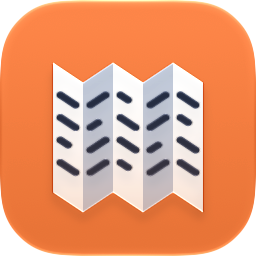
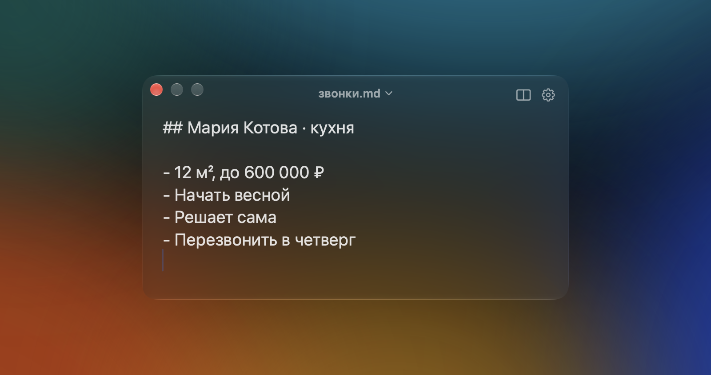
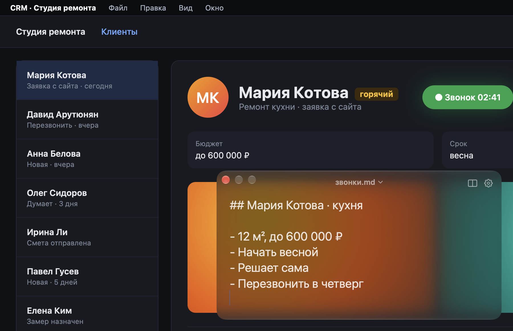
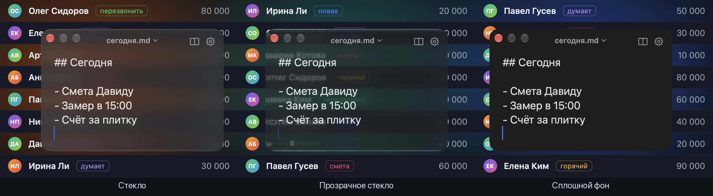
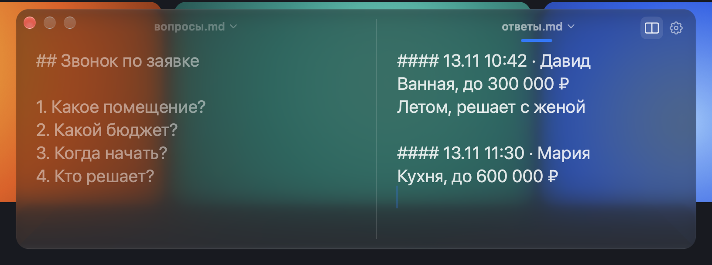

# Shpora

[English](README.md) · **Русский**

**Шпаргалка поверх всех окон.** Одна клавиша — и твой Markdown-файл над любой программой: печатаешь, и он уже сохранён. Сделана для звонков: звонилка или CRM на весь экран, а вопросы и заметки — сверху.



## Скачать

1. Скачай свежий **Shpora-….zip** со страницы [Releases](https://github.com/nagornik-icloud/shpora/releases/latest) и распакуй.
2. Перетащи **Shpora.app** в **Программы** и открой.
3. В первый раз macOS скажет, что не может проверить разработчика (программа пока не заверена Apple). Нажми **Готово**, затем открой **Системные настройки → Конфиденциальность и безопасность**, пролистай вниз и нажми **Всё равно открыть** рядом с Shpora. Это нужно один раз.

   Или в Терминале: `xattr -dr com.apple.quarantine /Applications/Shpora.app`
4. Нажми ⌃⌥J.

Работает на Mac с процессорами Apple и Intel, macOS 26 и новее.

## Что умеет

### Всегда перед глазами
⌃⌥J — и окно над любой программой, даже над полноэкранной. Фокус не забирает: звонилка, браузер или CRM продолжают работать. Ещё раз ⌃⌥J — окно спряталось.



### Три вида окна
Стекло, прозрачное стекло или сплошной фон — насколько окно просвечивает, решаешь ты. Светлое и тёмное оформление — по системе.



### Два файла рядом
⌘D открывает второй файл рядом: слева вопросы для звонка, справа ответы клиента. У края экрана окно само сдвигается, чтобы панель поместилась. Разделитель тянется мышью, ⌘[ / ⌘] — переход между панелями, ⌘W закрывает вторую.



### Живой файл
Окно — это и есть твой .md-файл: кнопки «Сохранить» нет. Правки на диске за долю секунды, а при скрытии окна, выходе и сне Mac — сразу. Запись надёжная (сначала во временный файл, потом подмена). Поменял файл в Obsidian или другом редакторе — окно подхватит; правил с двух сторон сразу — ничего не затрётся, твоя версия ляжет копией рядом.

## Ещё

- ⌘T вставляет строку с меткой времени (`#### 13.11 10:42 · `) — удобно начать новую запись.
- ⌘F поиск · ⌘+ / ⌘− / ⌘0 размер текста · ⌘O открыть файл в своей программе · Esc спрятать.
- Сочетания работают в любой раскладке, горячие клавиши меняются в настройках.
- Запоминает размер и место — отдельно для одной и двух панелей.
- Любой файл выбирается из меню под его именем, там же — добавить или создать.
- Значки в Dock и строке меню — по желанию, запуск при входе. Русский и английский.
- Переходишь с Markie? При первом запуске Shpora возьмёт оттуда список файлов (только чтение, Markie не трогает).

## Чего не умеет (намеренно)

- Не показывает Markdown оформленным: видишь и правишь простой текст.
- Нет синхронизации, аккаунтов и облака — файлы лежат там, куда ты их положил (положи в iCloud Drive или Dropbox, если нужна синхронизация).
- Нет истории версий, заметки дня и списков задач.

## В планах

- Автообновление (Sparkle).
- Сборка, заверенная Apple, чтобы macOS открывала её без лишнего шага.
- Установка через Homebrew.

Идеи и ошибки — в Issues.

## Сборка из исходников

Нужны macOS 26+, Xcode и [XcodeGen](https://github.com/yonaskolb/XcodeGen) (`brew install xcodegen`).

```bash
git clone https://github.com/nagornik-icloud/shpora.git
cd shpora
scripts/build.sh
```

Скрипт собирает Release, подписывает (твоим сертификатом Apple Development, если он есть, иначе локальной подписью) и кладёт в `/Applications/Shpora.app`. Дальше открой Shpora и нажми ⌃⌥J.

## Благодарности

Горячие клавиши: [KeyboardShortcuts](https://github.com/sindresorhus/KeyboardShortcuts), Sindre Sorhus (MIT).

## Лицензия

[MIT](LICENSE)
